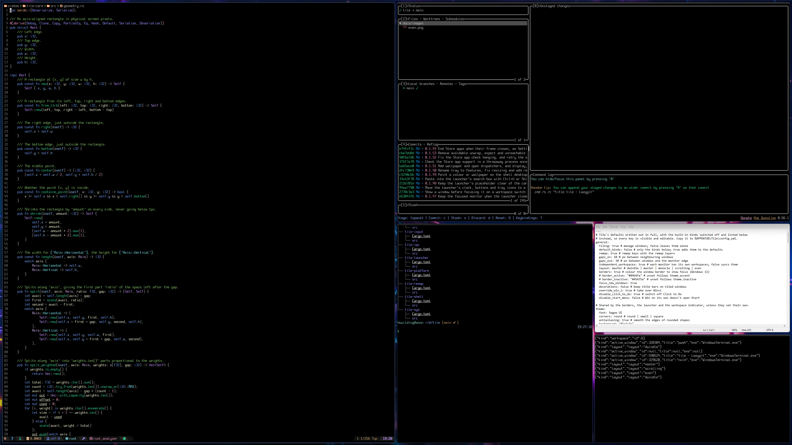
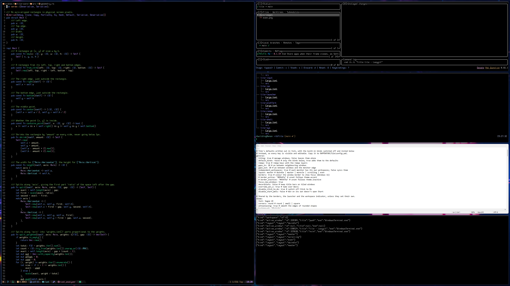
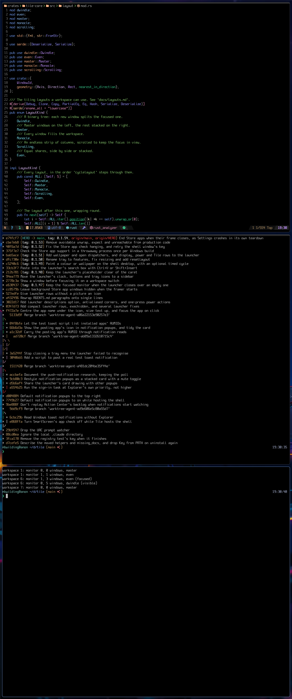
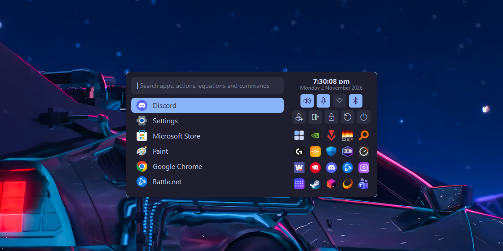
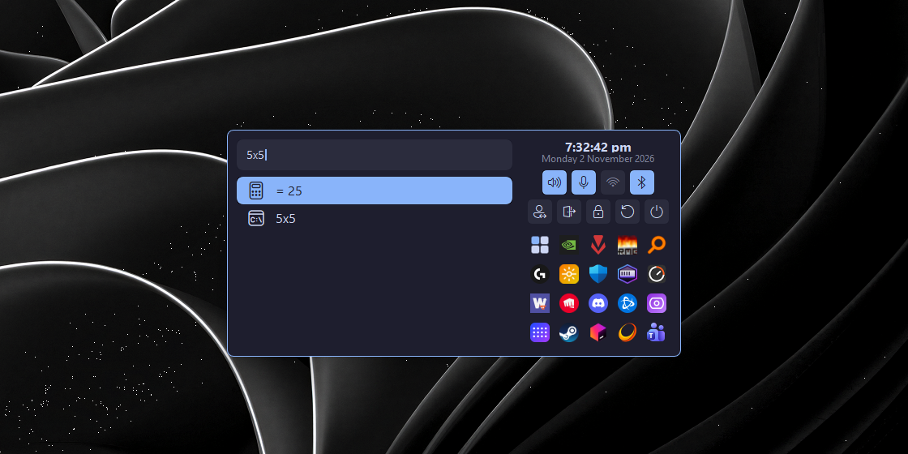
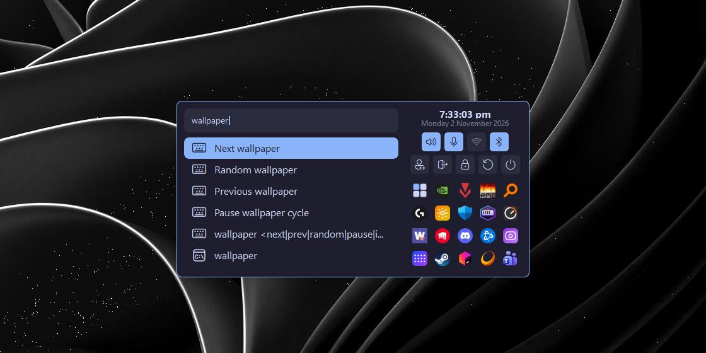
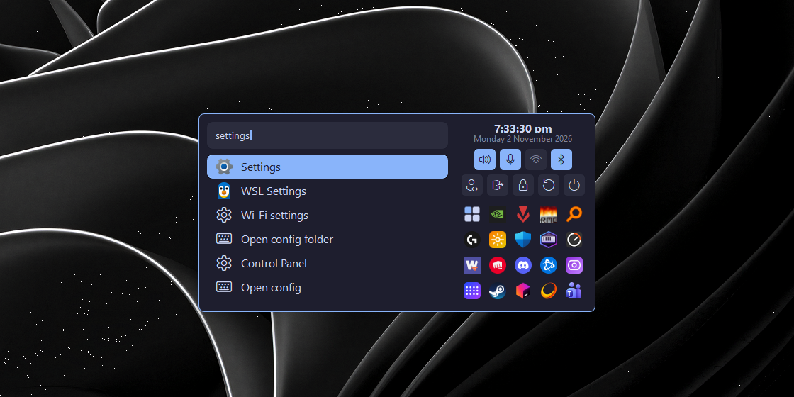

# Tile

A dynamic tiling window manager for Windows, with a key remapper built in (layers, home-row
mods, tap/hold keys). Either side can be switched off.
Written in Rust.

Keybinds are handled in-process by a low-level keyboard hook, including `Win` combos (the Start
menu is suppressed), so no separate hotkey program is needed.

## Why Tile

Windows gives you a pile of overlapping rectangles and asks you to arrange them yourself. Tile
does it for you. Open a window and it takes its place, close one and the rest fill the gap. Your
hands stay on the keyboard, and the layout is always tidy.

### One tool, not three

A tiling window manager, a hotkey daemon and a key remapper normally
means three programs to install, configure and keep running. Tile is a single small Rust
executable with one YAML file, and it reloads that file the moment you save it.

### Layouts that suit the work

Pick one per workspace and switch with a single key. The windows
keep their order when you do.

| | |
| --- | --- |
|  |  |
| **Dwindle**: every new window splits the focused one | **Master/stack**: one big window, the rest stacked beside it |

### Built for big and odd-shaped screens

Every monitor has its own workspaces, and Tile remembers the layout you last used on each one,
so a portrait monitor can stay on stacked rows.

### The launcher

`Win+R` searches everything Start lists, then goes further: it runs command lines, runs Tile
commands, does sums, and finds volume, Wi-Fi, Bluetooth, power and tray icon items. See
[Launcher](docs/launcher.md).

| | |
| --- | --- |
|  |  |
| **Fuzzy search** over everything Start lists, with icons | **Sums** answered as you type |
|  |  |
| **Tile's own commands**, ready to run | **Apps, system settings and Tile's config** in one search |

### Replace the Windows shell

Switch on [shell mode](docs/shell.md) and Tile becomes your
shell, so Explorer's taskbar, desktop and Start menu never run. All that is left is your tiled
windows, with the launcher doing the Start menu's job, tray icons and system controls included.
It is one tick in the tray menu, and unticking it brings Explorer back at your next sign-in.

### Keys that do what you mean

Home-row mods, tap/hold keys, layers and key sequences are built
in, with no second program and nothing to sync between the two.

### Scriptable

`tile query` prints state as JSON and `tile subscribe` streams events, so a
status bar or a script can follow along. `tile dispatch` runs anything a keybind can.

### Leaves no mess behind

Everything Tile changes is undone when it stops, even after a crash
or a hard kill.

## Features

- Five layouts, chosen per workspace: **dwindle**, **master/stack**, **monocle**, **scrolling** (a niri-style strip of columns) and **even** (equal shares, side by side or stacked)
- Numbered workspaces, independent per monitor (or synced, if you prefer); floating and fullscreen windows
- Native virtual desktops (Windows 11 24H2+): every desktop has its own workspaces and layouts
- Mouse: hold `Win` and drag a window; drag a tile onto another to swap them, or its edge to
  resize the split, with the other windows following as you drag
- Binds that start or focus a program (`Win+B` a new Chrome window, `Win+T` a new Windows
  Terminal window), and `Win+Q` to close, working even with tiling off
- An app launcher: fuzzy search over everything Start lists, with icons, that also runs command
  lines and Tile dispatchers, and finds volume, Wi-Fi, Bluetooth, power and tray icon items
- Optional [shell mode](docs/shell.md): run Tile instead of Explorer's taskbar, with tray icons
  and system items in the launcher
- A workspace indicator that flashes the workspace number or layout name when you switch
- Coloured focus borders (Windows 11) and eased move/resize animations
- Optional title bar removal for tiled windows, with per-app overrides
- Key remapping: layers, modifier layers, `overload()`, `overloadt()` and key sequences
- YAML config, applied live on save, with window rules
- Commands in `tile` itself: dispatch, query state as JSON, subscribe to events, check the
  config, install/uninstall
- Tray icon with switches for the window manager (Tile), the key remapper (Remap) and shell mode (Shell)
- Everything Tile changes is undone when it stops, including on a crash or a hard kill

## Quickstart

Download `Tile-Setup-<version>.exe` from the [latest release](https://github.com/mbwilding/tile/releases/latest)
and run it. It asks for admin rights once, installs Tile and starts it. To skip the installer,
download `Tile.exe` from the same page and run `.\Tile.exe install`.

Tile starts tiling straight away. Tick **Remap** in the tray icon to remap keys, and untick
**Tile** (or press `Win+Shift+P`) to pause tiling; launch and close keys work either way. Try:

| Keys | Action |
| --- | --- |
| `Win+Arrows` / `Win+H/J/K/L` | move focus, across monitors too |
| `Win+Shift+Arrows` / `Win+Shift+H/J/K/L` | move the window |
| `Win+1`…`Win+9` | switch workspace |
| `Win+Space` | next layout |
| `Win+B` / `Win+T` | Chrome / Windows Terminal |
| `Win+Q` | close the window |
| `Win+Shift+E` | exit |

All the keys are in [Keybinds](docs/keybinds.md).

The installer runs `tile install`, which sets Tile up to run as administrator, so it can manage
admin windows too, without a UAC prompt at sign-in:

- It copies `Tile.exe` to `C:\Program Files\Tile`, where only admins can change them.
- A scheduled task starts Tile elevated when you sign in. It runs on battery, is never stopped
  for running too long and runs at normal priority.
- A launcher (`Tile.exe --launcher`) starts with your normal rights from your `Run` key. Programs
  Tile starts, from `exec` binds or the tray, go through it, so they don't run as
  administrator.
- `C:\Program Files\Tile` goes on your user `PATH`, for `tile` in terminals started after your
  next sign-in.
- Tile is added to Apps & features.

It replaces a running Tile and asks for admin rights once. It also stops and removes the
standalone Key remapper (`C:\Program Files\Key`, its sign-in task and `PATH` entry) if that is
installed, since Tile remaps keys itself now; Key's config in `%APPDATA%\Key` is left alone. To
update, run the newer installer. Running programs never block an update, since the old files are
moved aside and deleted on the next install. Uninstall from Apps & features, or run
`tile uninstall`, to stop Tile and undo all of that, keeping your config and logs.

To try Tile without installing, run `Tile.exe` (or `Tile.exe -c my.yml` for another config file).
To build it yourself, see [Development](docs/development.md#running-a-build).

Only one Tile runs at a time. Run from a terminal, Tile stays in the foreground: stop it with
Ctrl-C, `Win+Shift+E`, the tray icon or `tile dispatch exit`. Closing the
terminal can leave windows hidden and the pointer blank until Tile next starts (see
[Windows integration](docs/windows-integration.md#undoing-changes)).

## Configuration

Tile runs on its built-in defaults. On first run it creates `%APPDATA%\Tile\config.yml` holding
only the `features` switches (Tile, Remap, Shell, Log), which it saves there as you change them.
Add a section and key to change anything else; saved changes apply immediately, and a broken
config turns the tray icon red while the last good one stays in use. [Configuration](docs/configuration.md) has every setting and the whole default
config to copy and paste, and [`examples/`](examples) has complete configs to start from.

## Documentation

| Page | Contents |
| --- | --- |
| [Configuration](docs/configuration.md) | Every setting, and the default config to copy |
| [Keybinds](docs/keybinds.md) | Default keys, key names, every dispatcher |
| [Layouts](docs/layouts.md) | The layouts, and per-monitor and multi-monitor behaviour |
| [Window rules](docs/window-rules.md) | Float, ignore or place windows by program, class or title |
| [Key remapping](docs/key-remapping.md) | Remap layers, overloads and their limits |
| [Launcher](docs/launcher.md) | The app launcher: searching, keys, launch history |
| [Shell mode](docs/shell.md) | Replace Explorer's taskbar: tray icons and system items in the launcher |
| [Command line](docs/cli.md) | The `tile` commands, console behaviour and the IPC pipe |
| [Windows integration](docs/windows-integration.md) | Tray, files, Win+L, admin windows, what gets undone |
| [Development](docs/development.md) | Crates, building, testing and the documentation rules |
